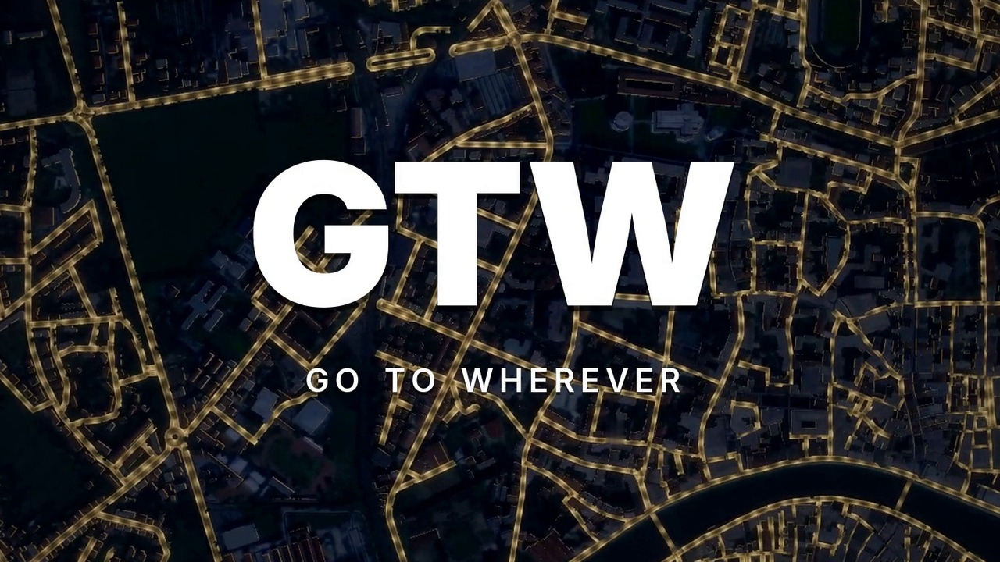

<div align="center">

# GTW — Go To Wherever

### An open-world sandbox on the real Earth: walk, drive, fly, and fight

Spawn anywhere on the planet, cross surface-aware terrain on foot, take a parked or moving car, and fly the aircraft you find at an airport. GTW builds on the upstream flight simulator and grows into a deeper ground sandbox, one feature at a time.

*GTW is a fork of [FableFlight](https://github.com/Rolandjg/fableflight), built in Rust with wgpu.*

<br>

[](https://www.rust-lang.org/)
<br>
</div>

## Trailer

<div align="center">

[](https://www.youtube.com/watch?v=erKL1zDbxv0)

[Watch the trailer on YouTube](https://www.youtube.com/watch?v=erKL1zDbxv0) (45 s, 1080p)

</div>

## Download

There is no packaged GTW release yet: build from source below. Releases, once published, will appear at <https://github.com/galatolofederico/gtw/releases>. The release launcher is **`gtw-launcher`** (`gtw-launcher.exe` on Windows).

## Compiling

GTW is a Rust 2024 project and needs **Rust 1.85+**. The package and Cargo binaries are all named for the game: **`gtw`** (the simulator), **`gtw-mcp`** (the optional AI copilot bridge) and **`gtw-launcher`** (the launcher).

### Platform prerequisites

- **Linux (Debian / Ubuntu):**
  ```sh
  sudo apt-get update && sudo apt-get install -y libasound2-dev libudev-dev pkg-config
  ```
- **Linux (Fedora):**
  ```sh
  sudo dnf install alsa-lib-devel systemd-devel pkgconf-pkg-config
  ```
- **macOS:** Xcode Command Line Tools (`xcode-select --install`).
- **Windows:** [Rust](https://www.rust-lang.org/tools/install) with the MSVC C++ Build Tools. On Windows x64, use **Visual Studio Installer** to modify your Build Tools installation and add **C++ ATL for x64/x86** under **Individual components**. ATL provides `atls.lib`, which the bundled DirectX shader compiler needs at link time.

### Build and run

```sh
cargo run --release
```

Or build the release binaries (`target/release/gtw`, `target/release/gtw-mcp` and `target/release/gtw-launcher`) with:

```sh
cargo build --release --locked
```

## Features

- **Ground play:** start on foot anywhere; walk, run, sprint, jump, step up kerbs, and climb or slide on slopes. Six surface classes (asphalt, concrete, gravel, grass, sand, snow/ice) change grip, speed, and footstep audio, and weather modifies them.
- **Cars:** take any of the eight existing road vehicles while parked or moving, drive them with single-body arcade physics, drift with the handbrake, shove other cars aside in solid two-way collisions, and get out again.
- **Flight:** the upstream aircraft, cockpits, systems, and flight model: Cessna 172RG, Robin DR400, Beechcraft A36 Bonanza, Boeing 747, Gulfstream G650, F/A-18, F-4, F-22, Concorde, SR-71, Starship, and downloadable [FlightGear aircraft](https://wiki.flightgear.org/FGAddon).
- **World:** real elevation, OpenStreetMap roads and buildings, ESA WorldCover land cover, satellite imagery, real METAR weather, seasonal and live snow, and a satellite/road minimap.
- **Controls:** remappable keyboard, joystick, throttle, pedals, and gamepad, with separate on-foot, car, and flight contexts in **Settings → Controls**.
- **Arcade mode:** optional boosts, missiles, and in-flight respawns, flight-only and off by default. Enable it in **Settings → General** or pass `--arcade`.
- **AI copilot:** optional MCP integration; see [docs/mcp.md](docs/mcp.md).
- **Upscaling:** bilinear, AMD FSR 1 and FSR 3.1 built in, and AMD FSR 4.1 downloaded from AMD on request (Windows, Radeon RX 6000 or newer), with a suggestion for your GPU. In **Settings → Graphics → Upscaling**; see [docs/upscaling.md](docs/upscaling.md).

The UI supports English (`en`), French (`fr`), and Korean (`ko`). Settings, bindings, and the resume snapshot are saved automatically.

## Starting a run

```sh
gtw --start foot                 # on foot at the default place
gtw --start car                  # in a car
gtw --start plane --airport EZE  # on an airport runway
gtw --place "Buenos Aires" --start foot
```

`--start` chooses the initial mode; without it the game uses the saved mode and place when a save exists. `--flat` gives a deterministic flat world for scripted runs, `--no-save` disables loading and autosave, and `--surface-probe LAT,LON` prints the elevation and surface classes for a point and exits. Run `gtw --help` for every flag.

## Default Controls

All bindings can be customized in **Settings → Controls**, which has separate **On foot**, **Car**, and **Flight** pages. In cockpit view, hover over switches, levers, and knobs to click, hold, or scroll them directly with the mouse (or the gamepad's aim dot).

### On foot

| Action | Default Key |
| --- | --- |
| Walk forward / back / left / right | `W` / `S` / `A` / `D` |
| Look up / down / left / right | `Arrow Up` / `Arrow Down` / `Arrow Left` / `Arrow Right` |
| Sprint (hold) | `Left Shift` |
| Jump | `Space` |
| Get in / interact | `E` |
| First / third person | `V` |

### In a car

| Action | Default Key |
| --- | --- |
| Throttle / brake and reverse | `W` / `S` |
| Steer left / right | `A` / `D` |
| Handbrake | `Left Shift` |
| Get out | `E` |
| Horn | `B` |

### In flight

| Action | Default Key |
| --- | --- |
| Pitch down / up | `W` / `S` |
| Roll left / right | `A` / `D` |
| Rudder left / right | `Q` / `E` |
| Throttle up / down | `Left Shift` / `Left Ctrl` |
| Pitch trim down / up | `Numpad 7` / `Numpad 1` |
| Wheel brakes / Parking brake | `B` / `.` |
| Flaps down / up a notch | `F` / `V` |
| Landing gear | `L` |
| Speedbrake / Braking chute | `/` |
| Thrust reversers (hold) | `Z` |
| Canopy open / close | `6` |
| Boost / Afterburner | `Space` |
| Auto-start / stop engine | `F4` |
| Battery master / Magnetos / Starter | `Insert` / `I` / `O` |
| Mixture richer / leaner | `Page Up` / `Page Down` |
| Autopilot toggle / HDG / NAV / APR / ALT | `F5` / `7` / `8` / `9` / `0` |
| Heading bug / Altitude preselect | `-` `=` / `;` `'` |

### Everywhere

| Action | Default Key |
| --- | --- |
| Camera (chase / cockpit) | `C` |
| HUD toggle (the minimap follows it on the ground) / Minimap in flight | `H` / `` ` `` |
| Full map | `J` |
| Go to place / Respawn / Pause | `G` / `R` / `P` |
| Flight panel / Back to the main menu | `Tab` / `Esc` |
| Sound toggle / Screenshot | `U` / `F12` |

## Configuration & Data Paths

| Platform | Config (settings, bindings, graphics, Google key, MCP token) | Cache (tiles, airport data, downloaded hangar cache) |
| --- | --- | --- |
| **Linux** | `~/.config/gtw/` | `~/.cache/gtw/` |
| **macOS** | `~/Library/Application Support/gtw/` | `~/Library/Caches/gtw/` |
| **Windows** | `%APPDATA%\gtw\` | `%LOCALAPPDATA%\gtw\` |

On the first start, GTW imports `settings.json`, `bindings.json`, `graphics.json`, `google_maps.json`, and `launcher.json` from an existing FableFlight config folder (`<config>/fablegame/`) once, and renames the old tile cache to `<cache>/gtw/` when it can. The game shows a notice when that happens; a file already in the GTW folder always wins. Downloaded aircraft and AMD's optional FSR runtime stay under `<data>/fablegame/`, because moving them would orphan files already downloaded.

The `FABLE_*` environment variables (`FABLE_GOOGLE_KEY`, `FABLE_GPU_TIMES`, `FABLE_MSAA`, `FABLE_PROGRESS` and the rest) keep their historical names for compatibility. The MCP bridge also reads `GTW_MCP_PORT` and `GTW_MCP_TOKEN` first, then the old `FABLEFLIGHT_MCP_*` names.

When using optional Google Maps imagery/3D tiles, prefer setting the `FABLE_GOOGLE_KEY` environment variable (or entering the key in **Settings → Map**) rather than passing `--google-key` on the command line.

## Troubleshooting

- **GPU startup or driver issues:** Run from a terminal to see GPU error output. Make sure Vulkan (Linux/Windows), DX12 (Windows), or Metal (macOS) drivers are up to date. On integrated GPUs, try `--graphics very-low` or set `FABLE_MSAA=1`.
- **Low frame rate / laptops without a dedicated GPU:** In **Settings → Graphics**, pick the **Very Low** preset (the first start on integrated graphics picks Very Low on Intel, Low elsewhere). For more speed, set **Clouds** to Off and lower **Render resolution** (down to 35%). A 30 fps **Frame limit** keeps the laptop cooler and saves battery. To see where the GPU time goes, run with `FABLE_GPU_TIMES=1`: it logs the time spent in each render stage.
- **No sound or switched headphones:** Audio automatically attempts to reopen the default output device every few seconds after a stream error. Use `U` to toggle mute or `--mute` to launch silently.
- **Offline / slow network:** Launch with `--offline` to fly and drive using only cached tiles and built-in data.
- **Linux gamepads not detected:** Ensure your user has read access to `/dev/input/event*` (usually the `input` group) and `libudev` is installed.
- **Invalid command-line flags:** Run `gtw --help` to see all supported options.
- **The game stops while starting from the launcher:** the launcher shows the game's last log lines, and the full log of the last run is in the cache folder as `last-run.log` (Home → Open the last game log).

## Multiplayer

Flight multiplayer is **not available in this version**. The game does not connect to the relay network, does not read its server list, and shows no multiplayer or server options in the menus. The multiplayer protocol, relay and drawing code remain in the source for a future release; see [docs/relay.md](docs/relay.md) for the development notes.

## Assets & Attributions

GTW is a fork of [FableFlight](https://github.com/Rolandjg/fableflight) and keeps its MIT-licensed code and upstream credit. The source code is licensed under the MIT License (see [LICENSE](LICENSE)). Bundled data and media assets include:

- **Ground land cover (cached under `lc/`):** ESA WorldCover 2021 v200, © ESA WorldCover project, licensed under [CC BY 4.0](https://creativecommons.org/licenses/by/4.0/), fetched through the [Microsoft Planetary Computer](https://planetarycomputer.microsoft.com/dataset/esa-worldcover) data API. Used for ground surface classes; OpenStreetMap data takes precedence where it exists.
- **Airports & navigation aids (`assets/airports.tsv.gz`, `assets/navaids.tsv.gz`):** Derived from [OurAirports](https://ourairports.com/data/) (Public Domain).
- **Night lights (`assets/night_lights.bin`):** Block-wise zlib-compressed global radiance tiles packed from NASA Earth Observatory's Black Marble 2016 dataset (Public Domain).
- **Fonts (`assets/fonts/`):** Barlow and IBM Plex Mono, licensed under the SIL Open Font License 1.1 (see `assets/fonts/OFL-Barlow.txt` and `assets/fonts/OFL-IBMPlexMono.txt`).
- **AMD FidelityFX Super Resolution:** `src/shaders/fsr3.wgsl` and the FSR 1/RCAS functions in `src/shaders/post.wgsl` are ported from AMD's FSR SDK v2.4.0 (MIT; notice in [docs/upscaling.md](docs/upscaling.md)). AMD's FSR 4 runtime is not bundled: it is downloaded from AMD at the player's request, under AMD's licence.
- **Google Maps badge (`assets/google_maps_logo.png`):** Displayed when optional Google Maps Platform imagery or Photorealistic 3D Tiles are enabled, per Google Maps attribution requirements.
- **Aircraft models, textures, and audio (`assets/*.bin.gz`, `assets/*_paint.jpg`, `assets/audio/`, `assets/ui/`):** Project-authored or procedural assets inherited from FableFlight and bundled with GTW. Optional downloadable aircraft from [FGAddon](https://wiki.flightgear.org/FGAddon) carry their own per-aircraft licenses recorded in each installed aircraft's `source.json`.

## Roadmap

GTW is built one feature at a time, and the [issue tracker](https://github.com/galatolofederico/gtw/issues) is the source of truth. Planned and in-progress work includes vehicle damage and handling, richer cars and characters, traffic AI, pedestrians, ground weapons, police and wanted levels, parachuting, and a more detailed street-level world.

## Contributing

Contributions are welcome; see [AGENTS.md](AGENTS.md) for coding standards and the verification steps.
